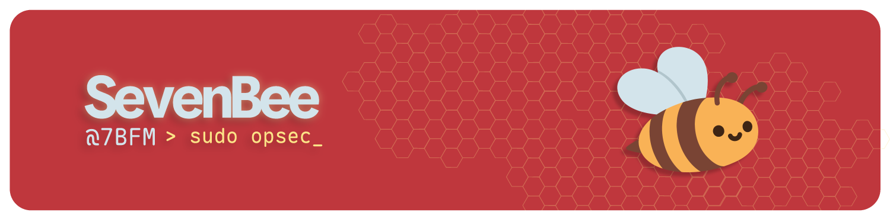

<h1><b>Hello!</b></h1>

Hello, I'm a for-hire Roblox game developer. I do everything from game logic and scripting to UI/UX design.

I'm currently working on several games, as well as a few of my own projects.  

Coding Languages I know:
* Luau (obviously): used for roblox games, started in 2019.
* Python: used for quick scripting, learned in 2020.
* Java: used for developing Minecraft mods and plugins, learned in 2020 (i had a lot of free time).
* Rust: learning it to make lightweight apps for by bad PC, picked it up in 2025.

The fastest way to reach me is through discord: @7b.fm
